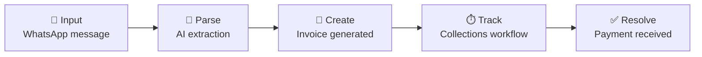

<div align="center">

# 📖 The Fables Lab

### Software designed for operational clarity.

*We build systems that reduce payment delays, structure workflows, and automate operational coordination for modern businesses.*

<br />

[](https://www.thefableslab.com)
[](https://the-fables-lab-complete-change.vercel.app)


</div>

---

## ✨ What is this?

**The Fables Lab V1** is a complete revamp of the original TheFablesLab website. It is the public face of an early-stage product studio based in **Chandigarh, India**, building operational infrastructure for businesses that run on credit and relationships.

The studio's first system is **Fables Flow**, the operational backbone for distribution businesses. The site presents it, along with the studio's principles and research, and gives interested businesses a way to get in touch.

> Businesses today are operationally fragmented. Chats live in WhatsApp, invoices live in spreadsheets, and follow-ups live in someone's memory. We believe operational software should reduce complexity, not add to it.

---

## 🌊 Fables Flow: from message to money

Fables Flow turns a casual WhatsApp message into a tracked, auditable payment workflow.



| Capability | What it does |
| --- | --- |
| **Invoice Workflows** | Order parsing → invoice creation → payment clearing, with full end-to-end visibility. |
| **Collections Systems** | Structured follow-ups driven by aging, payment priority, and retailer risk history. |
| **Retailer Coordination** | Interactions, claims, and returns logged into a single auditable record. |

> 🚧 Fables Flow is currently **in development**. This repository contains the studio website, not the Fables Flow product itself.

---

## 🧭 Principles

1. **Clarity over clutter.**
2. **Workflows over dashboards.**
3. **Calm systems over operational chaos.**
4. **Software should reduce cognitive overhead.**
5. **Infrastructure should feel invisible.**

---

## 🛠️ Tech Stack

| Layer | Choice |
| --- | --- |
| Framework | [Next.js](https://nextjs.org) (App Router) |
| Language | TypeScript |
| Styling | Tailwind CSS + PostCSS |
| Database | MongoDB (official Node driver) |
| Typography | [Geist](https://vercel.com/font) via `next/font` |
| Linting | ESLint |
| Hosting | Vercel |

---

## 🚀 Getting Started

### Prerequisites

- Node.js 18.18 or newer
- A MongoDB Atlas cluster (or any MongoDB instance)

### 1. Clone and install

```bash
git clone https://github.com/notbeingsuraj/The-Fables-Lab-V1.git
cd The-Fables-Lab-V1
npm install
```

### 2. Configure the environment

Copy the example file and fill in your values:

```bash
cp .env.example .env.local
```

| Variable | Purpose |
| --- | --- |
| `MONGODB_URI` | Atlas connection string. **Server-side only.** Never prefix with `NEXT_PUBLIC_`. |
| `MONGODB_DB` | Database name. Defaults to `fables_lab`. |
| `CONTACT_HASH_SALT` | Salt used to hash client IPs on contact submissions. |
| `ADMIN_PASSWORD` | Password for `/admin/*`. Rotating it invalidates all admin sessions. |

### 3. Set up the database

```bash
npm run db:setup    # create collections + $jsonSchema validators + indexes (idempotent)
npm run db:seed     # upsert the portfolio projects from scripts/data/projects-seed.ts
npm run db:verify   # connection, index, validator and round-trip checks
```

> Run `db:setup` first. `db:verify` assumes the schema already exists.

### 4. Run it

```bash
npm run dev
```

Open [http://localhost:3000](http://localhost:3000) and you're in.

---

## 🗄️ Database

All persistence is MongoDB. Two collections are defined in one place, `src/lib/db/schema.ts`, which is the single source of truth for TypeScript document types, the `$jsonSchema` validators applied to live collections, and the index list.

| Collection | Description |
| --- | --- |
| **`contacts`** | One document per contact-form submission. Public fields are `name`, `email`, `project_name`, and `architecture_details`. Everything else (`status`, `source`, `ipHash`, `userAgent`, `dedupeKey`, timestamps) is server-owned. Emails are lowercased on write, and `ipHash` is a salted SHA-256 rather than a raw IP. |
| **`projects`** | One document per portfolio case study, keyed by a unique lowercase `slug`. Re-seeding updates in place and preserves `createdAt`. |

### Layers

| Path | Role |
| --- | --- |
| `src/lib/mongodb.ts` | Lazy pooled connection singleton, reusing one client across hot reloads. |
| `src/lib/db/schema.ts` | Types, validators, and indexes. |
| `src/lib/db/contacts.ts`, `src/lib/db/projects.ts` | Repositories: validation, insert, query. |
| `src/lib/db/serialize.ts` | Documents → JSON, dropping internal fields. |
| `src/app/api/contact/route.ts` | Public write endpoint. |
| `src/app/api/projects/**` | Public read endpoints used by the client pages. |

MongoDB is only reachable from the server, so client pages fetch through the `/api` routes instead of holding a connection in the browser.

---

## 🔐 Admin

| Route | What you can do |
| --- | --- |
| `/admin/inquiries` | Browse contact submissions: filter by status, search, change status, delete. |
| `/admin/projects/new` | Create new portfolio projects. |

Access is gated by `src/app/admin/layout.tsx`, which redirects to `/admin/login` unless a valid signed session cookie is present. Every mutating server action re-checks the session, so the gate never relies on the layout alone.

---

## 📁 Project Structure

```text
The-Fables-Lab-V1/
├── public/            # Static assets
├── favicon(1)/        # Favicon set
├── scripts/           # DB setup, seed & verify scripts
│   └── data/          # Seed data (projects-seed.ts)
├── src/
│   ├── app/           # Routes, API handlers, admin
│   └── lib/           # MongoDB client + data layer
├── PRD.md             # Product requirements
├── DRD.md             # Design requirements
├── tasks.md           # Task breakdown
├── progress.txt       # Build progress log
├── .env.example       # Environment template
└── next.config.mjs
```

---

## ☁️ Deployment

The easiest path is [Vercel](https://vercel.com/new). Import the repo, add the four environment variables above in the project settings, and deploy. Run `npm run db:setup` against your production database once before the first launch.

---

## 🤝 Get in Touch

We are early-stage and selective. If you run a distribution business where operational friction is a real, daily problem, we'd like to hear from you.

[**Talk to us →**](https://www.thefableslab.com/contact)

[](https://x.com/thefableslab)
[](https://www.linkedin.com/company/109757348)
[](https://github.com/notbeingsuraj)

---

<div align="center">

**© 2026 The Fables Lab, Chandigarh, India**

*Calm systems. Invisible infrastructure.*

</div>
